<p align="center">
  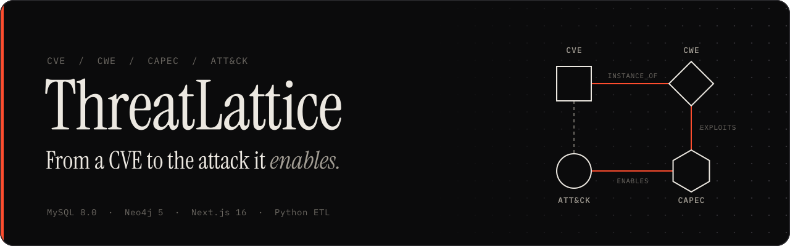
</p>

<p align="center">
  <a href="https://github.com/UltraBot05/ThreatLattice/actions/workflows/ci.yml"></a>
  
  
  
  
  <a href="LICENSE"></a>
</p>

<p align="center">
  <a href="#screenshots">Screenshots</a> ·
  <a href="#how-it-works">How it works</a> ·
  <a href="#quick-start">Quick start</a> ·
  <a href="#database-design">Database design</a> ·
  <a href="#documentation">Docs</a>
</p>

---

**ThreatLattice** is a security knowledge graph. It links four public catalogues so that one query walks from a real vulnerability to the attacker techniques it makes possible:

| Catalogue | What it is | Example |
|---|---|---|
| **CVE** (NVD) | a specific vulnerability in a specific product | `CVE-2026-109618`, a flaw in PHP's out-of-memory handling (CVSS 9.8, known exploited) |
| **CWE** (MITRE) | the kind of mistake behind it | `CWE-1325` Improperly Controlled Sequential Memory Allocation |
| **CAPEC** (MITRE) | an attack pattern that exploits that kind of mistake | `CAPEC-130` Excessive Allocation |
| **ATT&CK** (MITRE) | what an attacker does with it, as a technique | `T1499.003` Application Exhaustion Flood |

```
CVE  ──INSTANCE_OF──▶  CWE  ◀──EXPLOITS──  CAPEC  ──ENABLES──▶  ATT&CK technique
```

Analysts search and filter CVEs, open a dossier, explore the chain as a graph, and save what they find as investigations. Every change to an investigation is written to an audit log by database triggers.

Built for the PES University DBMS mini project (Level 3, Section 5A CSE, 2026) by **Abhigyan Dutta** (PES2UG24CS019) and **Akshansh Agrawal** (PES2UG24CS045).

## Screenshots

<table>
  <tr>
    <td width="50%">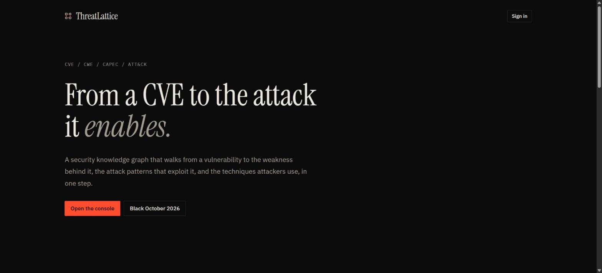<br><sub><b>Landing</b>: the chain, drawn as the four node shapes</sub></td>
    <td width="50%">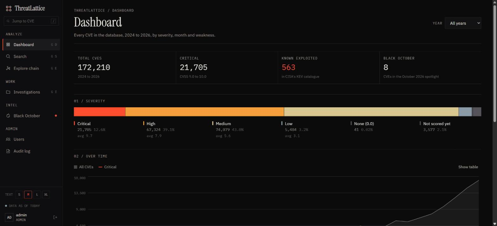<br><sub><b>Dashboard</b>: severity bands, monthly trend, KEV, top weaknesses</sub></td>
  </tr>
  <tr>
    <td>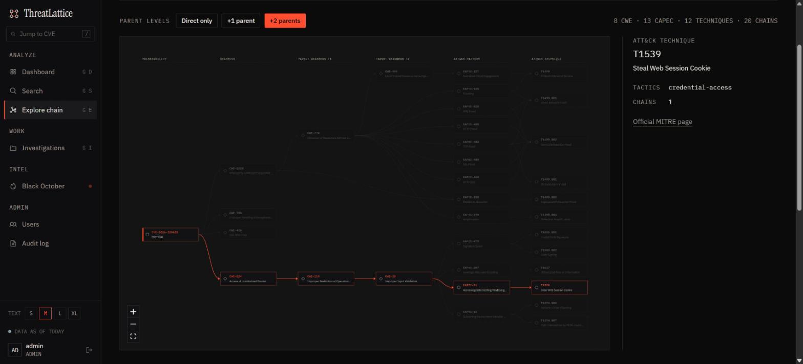<br><sub><b>Chain explorer</b>: CVE to techniques, through up to two parent CWEs</sub></td>
    <td>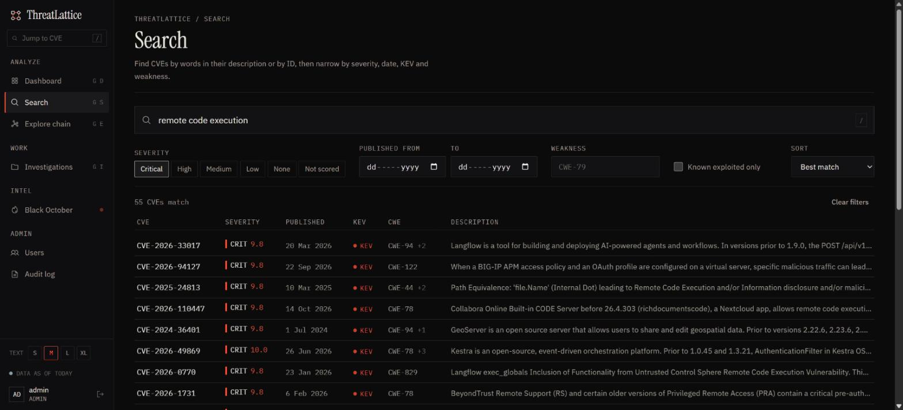<br><sub><b>Search</b>: full-text search with severity, date and KEV filters</sub></td>
  </tr>
  <tr>
    <td>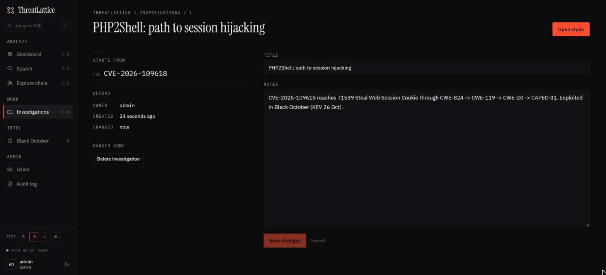<br><sub><b>Investigations</b>: saved by a stored procedure, audited by triggers</sub></td>
    <td>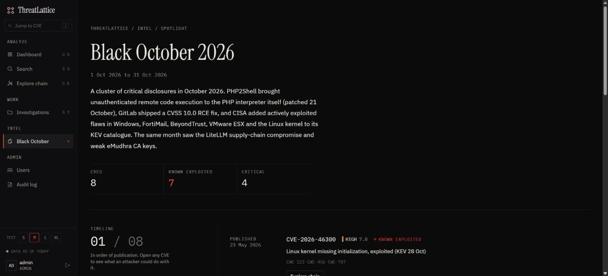<br><sub><b>Spotlight</b>: a curated incident, "Black October 2026"</sub></td>
  </tr>
</table>

<details>
<summary>More: audit log, SQL query results, constraint tests</summary>
<br>

| | |
|---|---|
| 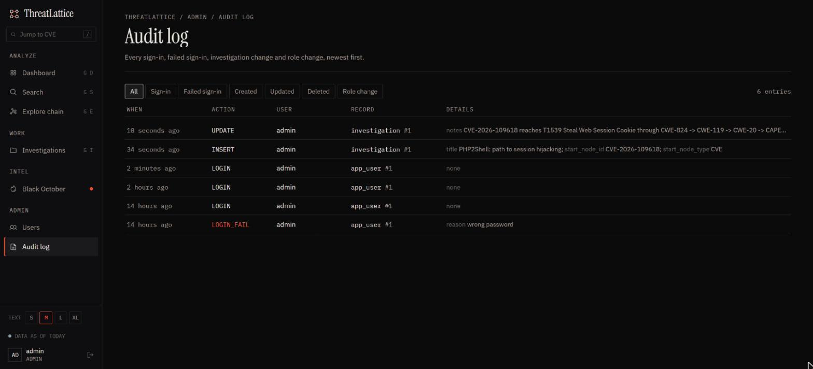 | 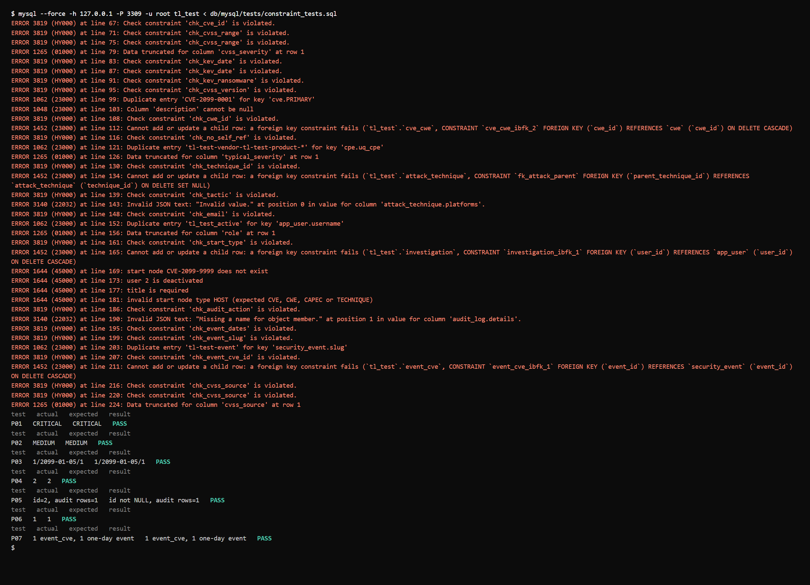 |
| **Admin audit log**: rows written by triggers and the auth API | **Constraint tests**: the database rejects bad data by itself |

The ten report queries (GROUP BY / HAVING, correlated and nested subqueries, joins, triggers, full-text search, a transaction with SAVEPOINT, views) each have a screenshot in [`docs/screenshots/sql/`](docs/screenshots/sql/).

</details>

## What you can do

| Page | What it shows | Database feature behind it |
|---|---|---|
| `/` | landing page with the animated chain | |
| `/dashboard` | severity bands, CVEs per month, KEV count, top weaknesses | views and `GROUP BY` |
| `/search` | search all CVEs by text, severity, date, KEV, CWE | `FULLTEXT` index, `MATCH ... AGAINST` in boolean mode |
| `/cve/[id]` | one CVE: score and who scored it (NVD, CNA or ADP), KEV status, weaknesses, affected products | joins across `cve`, `cve_cwe`, `cve_cpe`, `cpe` |
| `/explore/[cveId]` | the CVE to technique chain as a graph, direct or through 1 to 2 parent CWEs | Neo4j variable-length path |
| `/investigations` | saved findings, each starting from a CVE, CWE, CAPEC or technique | stored procedure + audit triggers in one transaction |
| `/spotlight/[slug]` | a curated incident and the CVEs linked to it | `security_event`, `event_cve` |
| `/admin/audit` | who did what: logins, failed logins, inserts, updates, deletes, role changes | `audit_log` written by triggers |
| `/admin/users` | change roles, deactivate accounts (the last admin cannot be demoted) | row locks with `SELECT ... FOR UPDATE` |

## How it works

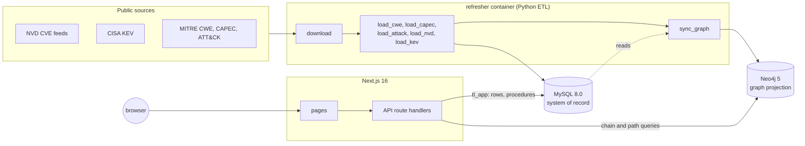

**Why two databases?** Most of the data is records with many attributes and strict rules: CVEs with scores and dates, users, investigations, an audit trail. That belongs in MySQL, with CHECK constraints, foreign keys, triggers and full-text search. The chain question is different: "which techniques can this CVE reach, through up to N parent weaknesses?" In SQL that is a recursive query over four junction tables. In Neo4j it is one pattern:

```cypher
MATCH (v:CVE {id: $id})-[:INSTANCE_OF]->(:CWE)-[:CHILD_OF*0..2]->(w:CWE)
      <-[:EXPLOITS]-(c:CAPEC)-[:ENABLES]->(t:Technique)
RETURN w, c, t
```

MySQL is the system of record. `sync_graph` projects it into Neo4j after every load, so the two never disagree for long. CAPEC links live only in Neo4j because they are only used for traversal, and storing them twice would mean keeping two copies in step.

### The data

Numbers from the snapshot used in the report (15 November 2026):

| | Count |
|---|---:|
| CVEs (NVD, 2024 to 2026) | 172,210 |
| of which in CISA KEV (known exploited) | 563 |
| CWE weaknesses and categories | 1,415 |
| CAPEC attack patterns | 558 |
| ATT&CK techniques (incl. 479 sub-techniques) | 706 |
| CVE to CWE links | 189,096 |
| CVE to product (CPE) links | 336,278 |

Of the 162,771 CVEs that name a weakness, **35.4%** reach an ATT&CK technique directly. Following up to two parent CWEs (`CHILD_OF`) raises that to **88.7%**, which is what the explorer's depth control shows.

A full refresh (download, load MySQL, rebuild the graph) takes about 1.5 minutes on an M4 Pro MacBook and about 3 minutes on a Windows desktop.

## Quick start

You need **Docker Desktop** (give it 6 GB of memory), **Node.js 22** and **Python 3.12**.

```bash
git clone https://github.com/UltraBot05/ThreatLattice.git && cd ThreatLattice
cp .env.example .env          # then set every password and AUTH_SECRET
```

Start MySQL, Neo4j and the refresher. On an empty database the refresher downloads about 150 MB and does the first full load by itself:

```bash
docker compose up -d --build
docker compose logs -f refresher     # wait for "refresh: done", then Ctrl+C
```

Create the demo accounts (`admin` and `analyst`, passwords from `.env`, or random ones printed once):

```bash
python3.12 -m venv .venv && source .venv/bin/activate     # Windows: .venv\Scripts\activate
pip install -r etl/requirements.txt
python -m etl.seed_users
```

Run the web app:

```bash
cd web && npm ci && npm run dev      # http://localhost:3000
```

Check that both databases are reachable: `http://localhost:3000/api/health` should return `{"mysql":true,"neo4j":true,...}`.

| Service | Address |
|---|---|
| Web app | http://localhost:3000 |
| Neo4j Browser | http://localhost:7474 |
| MySQL | `localhost:3307` (3307, so it never clashes with a local MySQL) |

<details>
<summary>Loading the data by hand instead of with the refresher</summary>
<br>

Every loader is idempotent and can be run again. Order matters:

```bash
python -m etl.download        # about 150 MB into data/raw/
python -m etl.load_cwe
python -m etl.load_capec
python -m etl.load_attack
python -m etl.load_nvd
python -m etl.load_kev
python -m etl.neo4j_schema
python -m etl.sync_graph      # prints the chain coverage at the end
python -m etl.seed_users
```

</details>

### Keeping the data current

The `refresher` container re-downloads every source and reloads both databases every `TL_REFRESH_DAYS` days (default 3.5). Users, investigations and the audit log are never touched. Only one refresh runs at a time (lock file), and after a failure it retries with back-off: 1 h, 2 h, 4 h, up to 24 h. The sidebar's "data as of" line shows how current the data is.

```bash
docker compose logs -f refresher                                  # watch a run
docker compose run --rm refresher python -m etl.refresh --once    # refresh now
```

To freeze the data (for screenshots or a demo), set `TL_REFRESH_DAYS=0` in `.env` and run `docker compose up -d refresher`. To wipe everything and start again: `docker compose down -v && docker compose up -d --build`.

## Database design

<p align="center">
  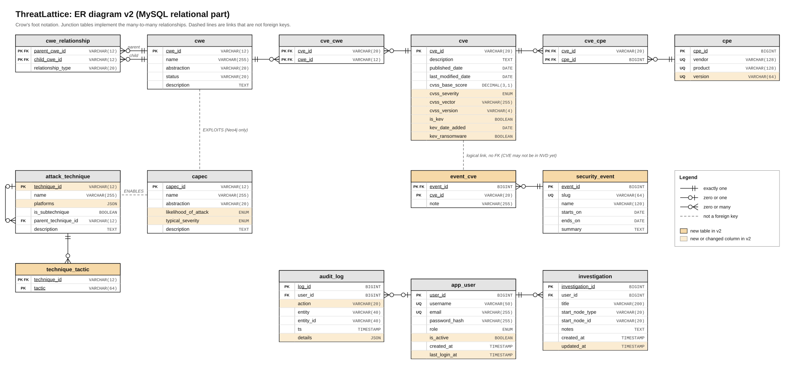
</p>

| Part | Objects |
|---|---|
| **Tables** (14) | `cve`, `cwe`, `cwe_relationship`, `cve_cwe`, `cpe`, `cve_cpe`, `capec`, `attack_technique`, `technique_tactic`, `app_user`, `investigation`, `audit_log`, `security_event`, `event_cve` |
| **Views** | `v_cve_summary`, `v_critical_cve`, `v_cwe_stats`, `v_severity_by_year` |
| **Procedures** | `sp_create_investigation` (validates and inserts in one transaction, raises `SIGNAL SQLSTATE '45000'` on bad input), `sp_severity_breakdown` |
| **Functions** | `fn_severity_band`, `fn_cwe_cve_count` |
| **Triggers** | `trg_cve_bi` / `trg_cve_bu` derive severity from the score; `trg_inv_ai` / `trg_inv_au` / `trg_inv_ad` write before and after values to the audit log (no-op updates skipped, case-only edits kept); `trg_user_au` logs role changes |
| **Grants** | the app connects as `tl_app`: `SELECT, INSERT, UPDATE, DELETE, EXECUTE` only, no DDL. Only the ETL uses root. |

A few design decisions worth knowing:

- **Normalisation.** ATT&CK tactics were a list on `attack_technique` in the first schema (not 1NF), so they moved to `technique_tactic`. Platforms stay as validated JSON because they are only displayed, never queried.
- **`event_cve` has no foreign key to `cve` on purpose.** A curated incident can name a CVE before NVD publishes it. A CHECK constraint still enforces the ID format.
- **The database defends itself.** [`constraint_tests.sql`](db/mysql/tests/constraint_tests.sql) sends 38 bad statements straight to MySQL (no API in between). All 38 are rejected by CHECK, ENUM, NOT NULL, UNIQUE, foreign keys, the JSON type or the procedure's SIGNALs. 9 valid statements must still pass. CI runs it on every push.

Run the tests against your own database:

```bash
bash db/mysql/tests/check_constraints.sh     # F-tests rejected: 38 / 38, P-tests PASS: 9 / 9
```

## Security

- No credentials in code. Everything comes from `.env`, which git ignores.
- Least-privilege database user for the app (see Grants above).
- Passwords are bcrypt hashes. Sessions are signed JWTs (HS256) in httpOnly, SameSite cookies, and every protected route re-checks the user in MySQL, so a deactivated account loses access at once.
- Sign-in is rate-limited per account, and the redirect after sign-in only accepts local paths.
- Every SQL statement uses placeholders and every Cypher query uses parameters.

## Repository layout

```
docker-compose.yml   MySQL (3307), Neo4j (7474, 7687) and the refresher
.env.example         every setting; copy to .env
db/mysql/            schema, views, routines, triggers, grants, seed (run at container init, in name order)
  queries/           the ten report queries
  tests/             constraint tests and check_constraints.sh
db/neo4j/            constraints and Cypher queries
etl/                 Python loaders, refresher and their tests
web/                 Next.js app: app/ (pages + API), components/, lib/ (db, auth)
docs/                data dictionary, ER diagram, testing results, screenshots, brand
```

## Documentation

| Document | What is in it |
|---|---|
| [Data dictionary](docs/data_dictionary.md) | every table and column, with keys, constraints and notes |
| [Testing results](docs/testing.md) | each constraint test, the expected and actual error, and observations |
| [ER diagram](docs/diagrams/er_v2.svg) | schema v2 ([draw.io source](docs/diagrams/er_v2.drawio)) |
| [Report queries](db/mysql/queries/report_queries.sql) | the ten SQL queries from the report, with [screenshots](docs/screenshots/sql/) |
| [Cypher queries](db/neo4j/02_queries.cypher) | chain, shortest path and graph-size queries |
| [Deliverable 1](docs/019_045_ThreatLattice.pdf) | requirements document (PDF) |

## Contributing

Every change goes through a pull request into `main`, which is protected (one approval, rebase merge only). Branch names: `feat/<issue>-<slug>`. Commit messages: `feat(db): ...`, `fix(etl): ...`, `docs: ...`. CI must pass before merging.

## Data sources and license

- CVE data from the [NVD](https://nvd.nist.gov/) (NIST). This product uses data from the NVD but is not endorsed or certified by the NVD.
- Known exploited vulnerabilities from the [CISA KEV catalog](https://www.cisa.gov/known-exploited-vulnerabilities-catalog).
- [CWE](https://cwe.mitre.org/), [CAPEC](https://capec.mitre.org/) and [ATT&CK](https://attack.mitre.org/) are © The MITRE Corporation and used under their terms of use.

The code is released under the [MIT License](LICENSE).
