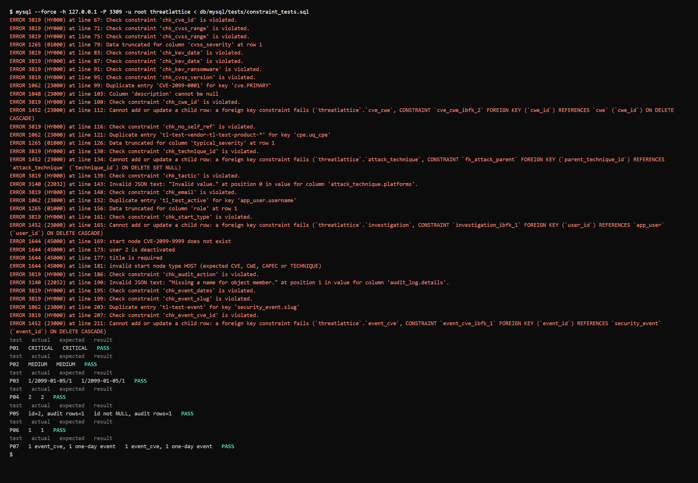

# Testing results: database-level validation

Test file: [`db/mysql/tests/constraint_tests.sql`](../db/mysql/tests/constraint_tests.sql)

## What is tested

The database must reject bad data by itself, whatever client sends it (the web API, the ETL scripts, or someone at the MySQL console). The API validates input too (zod), but these tests skip the API and talk straight to MySQL, so the only thing that can stop bad data here is the schema: CHECK constraints, ENUM types, NOT NULL, PRIMARY KEY / UNIQUE, FOREIGN KEY, the JSON type, and the `SIGNAL` checks inside `sp_create_investigation`.

- **F-tests**: 35 statements that must **fail**, each with its expected error written above it in the file.
- **P-tests**: 7 statements that must **succeed**, each followed by a `SELECT` that prints `PASS` or `FAIL`. They prove the constraints do not block valid data, and that the triggers and the procedure do their job.

## How to run

```
mysql --force --comments -vvv -u root -p threatlattice < db/mysql/tests/constraint_tests.sql
```

`--force` keeps going after each expected error. `--comments -vvv` echoes each test and its comment before the result, which is the view used for screenshots. The file creates its own test rows with IDs real data never uses (`CVE-2099-*`, `CWE-99900x`, `T999x`, users `tl_test_*`, events `tl-test-*`) and deletes them at the start and end, so it is safe to run on a loaded database and can be run again.

## Environment

| Item | Value |
|---|---|
| Server | MySQL Community 8.0.46 |
| sql_mode | `ONLY_FULL_GROUP_BY, STRICT_TRANS_TABLES, NO_ZERO_IN_DATE, NO_ZERO_DATE, ERROR_FOR_DIVISION_BY_ZERO, NO_ENGINE_SUBSTITUTION` (8.0 default) |
| Schema | `01_schema.sql`, `02_views.sql`, `03_routines.sql`, `04_triggers.sql` loaded on an empty database |
| Date | 2026-11-02 |

Strict mode matters: without it MySQL stores an invalid ENUM value as `''` with only a warning (F04, F15, F22 would then "pass" silently).

## Results: statements that must fail

| ID | Rule tested | Statement (short) | Expected | Actual | Result |
|---|---|---|---|---|---|
| F01 | CVE ID format | `cve_id = 'CVE-99-1'` | 3819 `chk_cve_id` | 3819 `chk_cve_id` is violated | Pass |
| F02 | Score ≤ 10.0 | `cvss_base_score = 11.0` | 3819 `chk_cvss_range` | 3819 `chk_cvss_range` is violated | Pass |
| F03 | Score ≥ 0.0 | `cvss_base_score = -1.0` | 3819 `chk_cvss_range` | 3819 `chk_cvss_range` is violated | Pass |
| F04 | Severity ENUM | `cvss_severity = 'SEVERE'` | 1265 data truncated | 1265 Data truncated for column 'cvss_severity' | Pass |
| F05 | KEV flag needs a date | `is_kev = TRUE`, no date | 3819 `chk_kev_date` | 3819 `chk_kev_date` is violated | Pass |
| F06 | KEV date needs the flag | set `kev_date_added` on a non-KEV CVE | 3819 `chk_kev_date` | 3819 `chk_kev_date` is violated | Pass |
| F07 | Ransomware only on KEV | `kev_ransomware = TRUE` on a non-KEV CVE | 3819 `chk_kev_ransomware` | 3819 `chk_kev_ransomware` is violated | Pass |
| F08 | CVSS version list | `cvss_version = '2.0'` | 3819 `chk_cvss_version` | 3819 `chk_cvss_version` is violated | Pass |
| F09 | CVE primary key | insert `CVE-2099-0001` twice | 1062 duplicate `cve.PRIMARY` | 1062 Duplicate entry 'CVE-2099-0001' for key 'cve.PRIMARY' | Pass |
| F10 | Description NOT NULL | `description = NULL` | 1048 cannot be null | 1048 Column 'description' cannot be null | Pass |
| F11 | CWE ID format | `cwe_id = 'XSS'` | 3819 `chk_cwe_id` | 3819 `chk_cwe_id` is violated | Pass |
| F12 | cve_cwe → cwe FK | link to `CWE-999999` | 1452 FK fails | 1452 FK `cve_cwe_ibfk_2` fails | Pass |
| F13 | No self-parent CWE | parent = child = `CWE-999001` | 3819 `chk_no_self_ref` | 3819 `chk_no_self_ref` is violated | Pass |
| F14 | Unique product (version defaults to `*`) | same vendor + product twice | 1062 duplicate `cpe.uq_cpe` | 1062 Duplicate entry 'tl-test-vendor-tl-test-product-*' for key 'cpe.uq_cpe' | Pass |
| F15 | CAPEC five-level ENUM | `typical_severity = 'CRITICAL'` | 1265 data truncated | 1265 Data truncated for column 'typical_severity' | Pass |
| F16 | Technique ID format | `technique_id = 'X123'` | 3819 `chk_technique_id` | 3819 `chk_technique_id` is violated | Pass |
| F17 | Sub-technique parent FK | parent `T9991` missing | 1452 FK fails | 1452 FK `fk_attack_parent` fails | Pass |
| F18 | Tactic short name | `tactic = 'Initial Access'` | 3819 `chk_tactic` | 3819 `chk_tactic` is violated | Pass |
| F19 | platforms is JSON | `platforms = 'Windows, Linux'` | 3140 invalid JSON | 3140 Invalid JSON text ... column 'attack_technique.platforms' | Pass |
| F20 | Email format | `email = 'not-an-email'` | 3819 `chk_email` | 3819 `chk_email` is violated | Pass |
| F21 | Unique username | `tl_test_active` twice | 1062 duplicate `app_user.username` | 1062 Duplicate entry 'tl_test_active' for key 'app_user.username' | Pass |
| F22 | Role ENUM | `role = 'root'` | 1265 data truncated | 1265 Data truncated for column 'role' | Pass |
| F23 | Start node type | direct insert with `'HOST'` | 3819 `chk_start_type` | 3819 `chk_start_type` is violated | Pass |
| F24 | investigation → app_user FK | `user_id = 999999999` | 1452 FK fails | 1452 FK `investigation_ibfk_1` fails | Pass |
| F25 | Procedure: node exists | `sp_create_investigation(..., 'CVE', 'CVE-2099-9999')` | 1644 start node ... does not exist | 1644 (45000) start node CVE-2099-9999 does not exist | Pass |
| F26 | Procedure: active user | deactivated test user | 1644 user ... is deactivated | 1644 (45000) user 2 is deactivated | Pass |
| F27 | Procedure: title required | title `'   '` | 1644 title is required | 1644 (45000) title is required | Pass |
| F28 | Procedure: node type | type `'HOST'` | 1644 invalid start node type | 1644 (45000) invalid start node type HOST (expected CVE, CWE, CAPEC or TECHNIQUE) | Pass |
| F29 | Audit action list | `action = 'HACK'` | 3819 `chk_audit_action` | 3819 `chk_audit_action` is violated | Pass |
| F30 | Audit details is JSON | `details = '{title: oops'` | 3140 invalid JSON | 3140 Invalid JSON text ... column 'audit_log.details' | Pass |
| F31 | Event dates order | ends 2099-10-01, starts 2099-10-31 | 3819 `chk_event_dates` | 3819 `chk_event_dates` is violated | Pass |
| F32 | Slug format | `slug = 'Tl Test Event'` | 3819 `chk_event_slug` | 3819 `chk_event_slug` is violated | Pass |
| F33 | Unique slug | `tl-test-event` twice | 1062 duplicate `security_event.slug` | 1062 Duplicate entry 'tl-test-event' for key 'security_event.slug' | Pass |
| F34 | Event CVE ID format | `cve_id = 'GITLAB-2026-1'` | 3819 `chk_event_cve_id` | 3819 `chk_event_cve_id` is violated | Pass |
| F35 | event_cve → security_event FK | `event_id = 999999999` | 1452 FK fails | 1452 FK `event_cve_ibfk_1` fails | Pass |

**35 / 35 rejected with the expected error.**

## Results: statements that must succeed

| ID | What it shows | Expected | Actual | Result |
|---|---|---|---|---|
| P01 | Valid CVE with score 9.8 and no severity; `trg_cve_bi` fills the band | `CRITICAL` | `CRITICAL` | PASS |
| P02 | Re-scoring to 5.5; `trg_cve_bu` re-derives the band | `MEDIUM` | `MEDIUM` | PASS |
| P03 | Valid KEV entry (flag + date + ransomware) | `1/2099-01-05/1` | `1/2099-01-05/1` | PASS |
| P04 | Valid sub-technique with existing parent, JSON platforms, short-name tactic | 2 techniques | 2 | PASS |
| P05 | `sp_create_investigation` valid call: returns id, writes one audit row (trigger, same transaction) | id not NULL, 1 audit row | id=2, 1 audit row | PASS |
| P06 | The four failed procedure calls (F25–F28) rolled back completely | 1 investigation for the test users | 1 | PASS |
| P07 | Event CVE not yet in NVD (no FK on purpose) and a one-day event | 1 event_cve, 1 one-day event | 1, 1 | PASS |

**7 / 7 passed.**

## Observations

- **Re-runnable.** A second run on the same database printed identical results and the cleanup left 0 test rows behind.
- **AUTO_INCREMENT gaps are normal.** In P05 the new investigation got id 2, not 1. F24 (foreign key failure) had already used id 1: InnoDB hands out the AUTO_INCREMENT value before it checks the foreign key, and never gives it back. F23 did not use one, because CHECK constraints are tested before the row reaches InnoDB (verified separately with a probe table). No code depends on ids being consecutive.
- **Error classes.** CHECK constraints → 3819, ENUM in strict mode → 1265, NOT NULL → 1048, duplicate key → 1062, missing parent row → 1452, invalid JSON → 3140, our own business rules → 1644 with SQLSTATE `45000`. The investigations API maps 1644 to a 400 response and shows the message as it is.

## Screenshot

Output of the run above (mysql client, `--force`, local test server on port 3309), rendered from the captured console output. Without `-vvv` the client prints only the errors and the result rows; every `ERROR` line is one F-test in file order.


